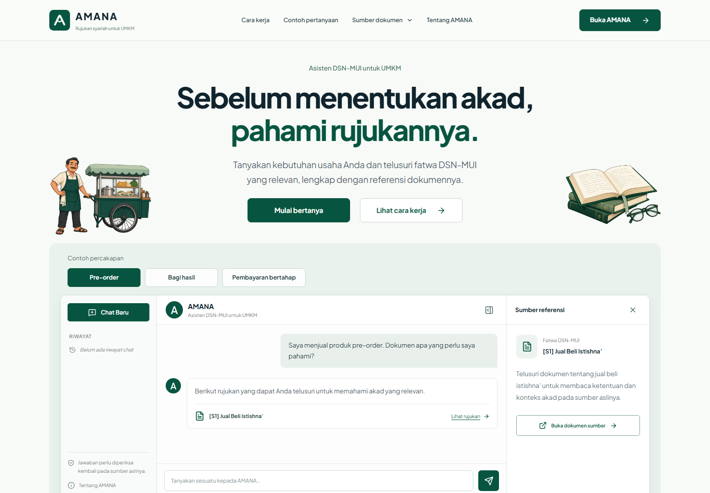
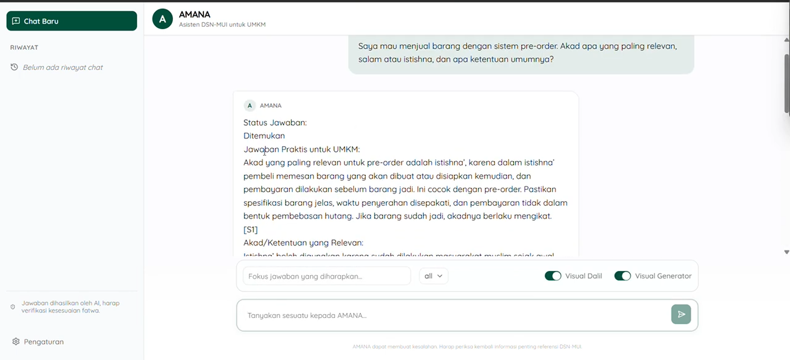

# AMANA · DSN-MUI UMKM RAG

Prototipe asisten untuk membantu UMKM menelusuri fatwa, pedoman implementasi, dan ta'limat DSN-MUI. **AMANA** menyediakan antarmuka chat berbasis React, sedangkan backend FastAPI menjalankan pipeline Retrieval-Augmented Generation (RAG).



Landing page tersedia di `/`, percakapan di `/chat`. Preview landing page dapat dicoba tanpa menjalankan model. Lihat [panduan antarmuka dan routing](docs/interface.md).



*Tampilan prototipe dari [Website-Porto](https://github.com/Ditt-A/Website-Porto/blob/f188a6af30baaa933b503dc71d5dea4c163546bc/public/images/projects/amana.png). Kode frontend diadaptasi dari [sulthonaw/amana-chatbot](https://github.com/sulthonaw/amana-chatbot); frontend dan backend kini tersedia di repo ini.*

## Fitur

- Landing page responsif dengan tab contoh percakapan, panel sumber, accordion pertanyaan, dan transisi yang mengikuti preferensi reduced motion.
- Delapan ilustrasi khusus UMKM dan rujukan, logo AMANA dalam SVG, serta navbar dengan dropdown dokumen. [Lihat aset dan penempatannya](docs/assets/README.md).
- Chat berbahasa Indonesia dengan filter kategori dokumen dan fokus pertanyaan.
- Hybrid retrieval: embedding **BGE-M3**, **BM25**, **Reciprocal Rank Fusion**, dan statistical reranker.
- Jawaban beserta referensi dokumen, halaman, support score, dan metadata proses.
- **Qwen3-VL** opsional untuk ekstraksi dalil Arab dari crop PDF dan penyusunan jawaban; fallback ekstraktif tersedia.
- Pipeline terpisah untuk crawling, ekstraksi halaman/OCR, chunking, dan pembuatan indeks.
- **Mode preview tanpa model** untuk membuka UI dan memeriksa API tanpa GPU atau artifact retrieval.

## Struktur repository

```text
DSNMUI_RAG/
├── frontend/                     # AMANA: React + TypeScript + Vite
│   ├── src/
│   │   ├── components/           # Komponen chat dan UI
│   │   ├── hooks/                # Request chat dan state filter
│   │   ├── lib/                  # Utility frontend
│   │   ├── pages/                # Landing, percakapan, dan informasi proyek
│   │   ├── types/                # Kontrak response RAG
│   │   └── App.tsx
│   ├── .env.example              # Target API dan key untuk proxy Vite
│   └── package.json
├── backend/                      # FastAPI dan pipeline Python
│   ├── src/dsnmui_rag/           # Retrieval, context, generation, visual dalil
│   ├── scripts/                  # Crawler, OCR, embedding, indexing
│   ├── tests/                    # Tes kontrak API tanpa model
│   ├── legacy/                   # Export notebook referensi
│   ├── app_rag_api.py            # Endpoint FastAPI
│   ├── app_streamlit.py          # UI eksperimen Streamlit
│   ├── cli.py                    # Eksperimen melalui terminal
│   ├── .env.example
│   └── pyproject.toml
└── docs/                         # Panduan penggunaan, deployment, dan gambar
```

## Mulai cepat: preview tanpa model

Prasyarat: **Python 3.10+** dan **Node.js 22+**. Jalankan dari hasil clone repo ini. Perintah di bawah menggunakan dua terminal terpisah.

**1. Backend — tanpa mengunduh atau memuat model**

```bash
cd backend
python -m venv .venv
```

Aktifkan environment: `source .venv/bin/activate` pada Linux/macOS atau `.venv\Scripts\Activate.ps1` pada PowerShell. Lalu:

```bash
python -m pip install -r requirements-test.txt
python -m pip install --no-deps -e .
```

Salin `backend/.env.example` menjadi `backend/.env`. Biarkan `RAG_LOAD_PIPELINE=0`, `PRELOAD_BGE=0`, dan `PRELOAD_VL=0`, kemudian jalankan dari folder `backend/`:

```bash
python -m uvicorn app_rag_api:app --env-file .env --host 127.0.0.1 --port 8300
```

API tersedia di <http://127.0.0.1:8300>, dokumentasi interaktif di <http://127.0.0.1:8300/docs>, dan health check di <http://127.0.0.1:8300/health>.

**2. Frontend — terminal baru dari root repo**

```bash
cd frontend
npm ci
```

Salin `frontend/.env.example` menjadi `frontend/.env.local`. Samakan `RAG_API_KEY` dengan konfigurasi backend, lalu:

```bash
npm run dev
```

Buka <http://localhost:3000> untuk landing page atau <http://localhost:3000/chat> untuk percakapan. Dalam mode preview, UI dan dokumentasi API dapat dibuka; endpoint jawaban mengembalikan **503** karena pipeline sengaja tidak diaktifkan. Tidak ada model atau dataset yang diperlukan untuk mode ini. Memilih contoh pertanyaan mengisi draft di halaman chat dan tidak mengirimkannya otomatis.

## Mengaktifkan RAG

Inference memerlukan dependency lengkap serta artifact `chunks.jsonl`, `embeddings_bge_m3.npy`, dan `bm25_index.pkl`. Model baru dimuat saat fitur terkait dijalankan atau preload diaktifkan. Lihat [panduan penggunaan](docs/usage.md) dan [preprocessing](docs/preprocessing.md) sebelum mengubah `RAG_LOAD_PIPELINE=1`.

```text
AMANA (browser)
    → /rag/ask melalui proxy Vite saat pengembangan
    → FastAPI
    → BGE-M3 + BM25 → RRF → reranker
    → context → Qwen3-VL opsional / fallback ekstraktif
    → jawaban + sumber referensi
```

API key disisipkan oleh server proxy Vite; key tidak ditanam di kode browser. Build statis memerlukan reverse proxy dengan rute `/rag/ask` yang sama, seperti dijelaskan di [panduan integrasi](docs/integration.md).

## Dokumentasi dan validasi

| Panduan | Isi |
|---|---|
| [Penggunaan RAG](docs/usage.md) | Arsitektur, konfigurasi model, Streamlit, CLI, kontrak API, troubleshooting |
| [Preprocessing](docs/preprocessing.md) | Crawling PDF, OCR, embedding, dan artifact retrieval |
| [Integrasi frontend/backend](docs/integration.md) | Proxy lokal, environment variable, build, dan deployment statis |
| [Antarmuka dan routing](docs/interface.md) | Halaman, tujuan tombol, transisi, dan pengujian browser desktop/mobile |
| [FastAPI dan ngrok](docs/deployment.md) | Menjalankan API dan menguji tunnel demo |
| [Asal kode dan gambar](docs/sources.md) | Sumber frontend, backend, dan screenshot prototipe |

Validasi tanpa model:

```bash
# Dari frontend/
npm run build
npm run test:e2e

# Dari backend/ dengan environment preview aktif
python -m pytest tests -q
```

Jawaban bergantung pada corpus dan kualitas ekstraksi dokumen. Kutipan Arab dan kesesuaian fatwa tetap perlu diverifikasi terhadap sumber aslinya. Prototipe ini belum mencakup autentikasi pengguna atau penyimpanan riwayat chat.
